# KyndForm Enhancements & File Tree Documentation

> **Project:** `KyndForm` (`thewaqasPro/KyndForms`)  
> **Origin Base:** Evolved from open-source HeyForm (v3.0.1)  
> **Repository Status:** Fully detached standalone application  
> **Documentation Date:** October 2026

This document provides a comprehensive breakdown of all custom features, architectural systems, bug fixes, and extensions built into KyndForm, along with a visual file tree of all custom and modified modules.

---

## 1. Executive Summary of Enhancements

```mermaid
graph TD
    A["KyndForm Fork"] --> B["Core Infrastructure"]
    A --> C["Backend Server Enhancements"]
    A --> D["Frontend Webapp Enhancements"]
    A --> E["Brand & Safety Guardrails"]

    B --> B1["Consolidated Single Root Lockfile"]
    B --> B2["New Package: @kyndform/answer-utils"]
    B --> B3["Multi-Stage Unified Docker Build (Port 8000)"]

    C --> C1["Headless Form Engine (POST /f/:id)"]
    C --> C2["Dynamic Field & Hidden Field Auto-Discovery"]
    C --> C3["SSRF Outbound Hardening & Bot Protection"]
    C --> C4["Mongoose Document<string> Nanoid Typing"]

    D --> D1["Headless Code Generator Modal (cURL/HTML/JS)"]
    D --> D2["JSON Form Schema Import (FormService)"]
    D --> D3["OAuth App Integration Helpers"]
    D --> D4["Modern Sass Compiler & React 19 Fixes"]

    E --> E1["Architecture Integrity Checker (pnpm verify:integrity)"]
    E --> E2["Dokploy Production Launch Plan"]
    E --> E3["Standalone Architecture Specification"]
```



---

## 2. Feature & Architecture Breakdown

### A. Core Monorepo & Infrastructure
1. **Consolidated Root Lockfile Policy**:
   - Upstream HeyForm maintained fragmented nested lockfiles (`packages/server/pnpm-lock.yaml`, `packages/webapp/pnpm-lock.yaml`, etc.), causing version drift.
   - KyndForm enforces a single root `pnpm-lock.yaml`. Nested lockfiles are prohibited.
2. **New Workspace Package (`@kyndform/answer-utils`)**:
   - A dedicated workspace package created to standardize submission payload parsing, answer sanitization, HTML conversion, and field flattening.
   - Fully covered by 113 unit tests via Vitest (`pnpm test`).
3. **Unified Single-Port Docker Production Build**:
   - Production Docker image compiles both the frontend Vite webapp and NestJS server, mounting webapp static bundles directly into the server.
   - Serves both the web dashboard and GraphQL API on a single port (**`8000`**), eliminating multi-container proxy complexity in Dokploy / Traefik.
4. **Enhanced Health & Readiness Probe**:
   - `/health`: Basic process uptime check.
   - `/health/ready`: Probes both MongoDB read/write and Redis ping before allowing reverse proxy ingress traffic.

---

### B. Backend Server Enhancements (`packages/server`)
1. **Headless Form Submission Engine**:
   - **Routes:** `POST /f/:formId`, `POST /api/f/:formId`
   - External clients (HTML static forms, Next.js / Astro frontends, mobile apps, cURL) can post directly to forms without loading the HeyForm JavaScript runtime.
2. **Dynamic Field Auto-Discovery & Type Inference**:
   - When external forms send unmapped fields, the controller automatically detects data types (`NUMBER`, `DATE`, `LONG_TEXT`, `SHORT_TEXT`, `FULL_NAME`).
   - Automatically appends newly discovered fields to the form schema in MongoDB when `autoCreateFields` is enabled.
   - Automatically extracts and indexes hidden fields (`utm_source`, `utm_medium`, `ref`, `client_id`).
3. **Multi-Tier Spam & Anti-Bot Protection**:
   - Built-in honeypot detection (`_gotcha`, `_honeypot`, `_bot`).
   - Integration with Google reCAPTCHA v2/v3 and Akismet spam classification.
   - Client IP submission rate limiter (`SubmissionIpLimitService`).
4. **SSRF & Private Network Hardening**:
   - Custom outbound request validator (`outbound-url.ts`) blocks webhook integrations from communicating with private Docker bridge networks (`172.16.x.x`), loopback (`127.0.0.1`), or cloud metadata services (`169.254.169.254`).
5. **Mongoose 7/8 Nanoid String Typing**:
   - HeyForm models use nanoid strings for primary keys (`_id: string`) rather than MongoDB `ObjectId`.
   - Updated model classes (`FormModel`, `TeamModel`, `ProjectModel`, `BrandKitModel`, `AppCodeModel`) to inherit `Document<string>` to guarantee compile-time type safety.
6. **MongoDB Sensitive Data Redaction**:
   - Development debug logger automatically masks passwords, session tokens, and secrets in database query logs.

---

### C. Frontend Webapp Enhancements (`packages/webapp`)
1. **Headless Form Developer Modal**:
   - UI modal integrated into the **Share** dashboard (`HeadlessModal.tsx`).
   - Generates interactive, ready-to-copy code snippets in:
     - Standard HTML Form markup
     - JavaScript `fetch()` API
     - cURL terminal command
2. **JSON Form Schema Import**:
   - Adds a local `.json` file upload button to the form template picker (`TemplatesModel.tsx`).
   - Implemented `FormService.importFromJSON(projectId, formJson)` to import questions, field layouts, logic branches, and custom themes in one click.
3. **OAuth App Authorization Service**:
   - Added `AppService.detail(clientId)` and `AppService.authorizationCode(...)` to support third-party OAuth 2.0 app authorization flows.
4. **Build & Typing Compatibility**:
   - Upgraded Sass preprocessor configuration to `api: 'modern-compiler'` in `vite.config.mts` to eliminate legacy Sass deprecation warnings.
   - Resolved React 19 synthetic event mapping (`onInput` -> `onChange`) and context typing in `InputOTP.tsx`.
   - Smart auth flow: Routes users directly to `/` after sign-up if `VERIFY_USER_EMAIL=false` instead of stranding them on the OTP verification page.

---

### D. Architecture Integrity & Verification Framework
1. **Architecture Integrity Script (`pnpm run verify:integrity`)**:
   - Programmatically tests 14 critical areas of the codebase to confirm that headless endpoints, answer-utils, media library, CodeBlock syntax highlighting, and monorepo configurations remain intact.
2. **Architecture Registries & Production Runbooks**:
   - `docs/KYNDFORM_ARCHITECTURE_SPEC.md`: Technical specification cataloging all architectural capabilities, custom schemas, and endpoints.
   - `docs/STANDALONE_ARCHITECTURE_GUIDE.md`: Developer guide detailing monorepo package topology and extension guidelines.
   - `docs/DOKPLOY_LAUNCH_PLAN.md`: Complete production deployment runbook with all environment variables.
   - `AGENTS.md`: Mandatory developer rules for preserving custom features and enforcing verification protocols.

---

## 3. Visual File Tree of Additions and Modifications

```text
kyndForms/
├── AGENTS.md                                     [MODIFIED] Standalone repository rules & verification protocols
├── Dockerfile                                    [MODIFIED] Multi-stage build with port 8000 & unified runner
├── package.json                                  [MODIFIED] Added root scripts (verify:integrity, test)
├── pnpm-lock.yaml                                [MODIFIED] Consolidated single root lockfile
├── pnpm-workspace.yaml                           [MODIFIED] Includes packages/answer-utils
│
├── docs/
│   ├── DOKPLOY_LAUNCH_PLAN.md                    [NEW] Dokploy deployment guide & production env variables
│   ├── KYNDFORM_ARCHITECTURE_SPEC.md             [NEW] Technical catalog of custom architecture & schemas
│   ├── KYNDFORM_ADDITIONS_AND_FILE_TREE.md       [NEW] This comprehensive documentation
│   └── STANDALONE_ARCHITECTURE_GUIDE.md          [NEW] Standalone developer architecture & extension guide
│
├── scripts/
│   └── verify-integrity.js                       [NEW] Automated 14-point architecture integrity test script
│
├── packages/
│   ├── answer-utils/                             [NEW PACKAGE] Custom utility package for form answers
│   │   ├── package.json                          [NEW] Package metadata & exports
│   │   ├── tsconfig.json                         [NEW] TypeScript compiler config
│   │   ├── tsup.config.ts                        [NEW] Dual CJS/ESM bundling config
│   │   ├── src/
│   │   │   ├── index.ts                          [NEW] Main module entrypoint
│   │   │   ├── apply-logic-to-fields.ts          [NEW] Dynamic field visibility & logic evaluation
│   │   │   ├── convert-field-to-answer.ts        [NEW] Payload to database answer format mapper
│   │   │   ├── flatten-fields.ts                 [NEW] Deep field flattener for nested questions
│   │   │   ├── html-utils.ts                     [NEW] Safe HTML rendering & escaping utilities
│   │   │   ├── transform-answer.ts               [NEW] Answer normalization per question kind
│   │   │   └── validate-payload.ts               [NEW] Submission validation schema
│   │   └── test/                                 [NEW] 20 test suites (113 passing unit tests)
│   │
│   ├── server/                                   [MODIFIED] Backend NestJS API
│   │   ├── src/
│   │   │   ├── app.module.ts                     [MODIFIED] Controllers auto-loading & rate-limiting
│   │   │   ├── config/
│   │   │   │   ├── mongo/index.ts                [MODIFIED] Dynamic SSL CA attachment & debug redaction
│   │   │   │   └── smtp/index.ts                 [MODIFIED] SMTP Brevo / TLS configuration
│   │   │   ├── controller/
│   │   │   │   ├── index.ts                      [MODIFIED] Exports HeadlessFormController
│   │   │   │   ├── dashboard.controller.ts       [MODIFIED] Runtime config injection & view rendering
│   │   │   │   ├── headless-form.controller.ts   [NEW] Headless form submission & auto-discovery engine
│   │   │   │   └── health.controller.ts          [MODIFIED] /health and /health/ready readiness probes
│   │   │   ├── environments/
│   │   │   │   └── index.ts                      [MODIFIED] Port 8000, SSRF flags, and runtime env parser
│   │   │   ├── model/                            [MODIFIED] Mongoose Document<string> nanoid typing
│   │   │   │   ├── app-code.model.ts             [MODIFIED] Document<string> ID typing
│   │   │   │   ├── brand-kit.model.ts            [MODIFIED] Document<string> ID typing
│   │   │   │   ├── form.model.ts                 [MODIFIED] Document<string> ID typing & custom schemas
│   │   │   │   ├── project.model.ts              [MODIFIED] Document<string> ID typing
│   │   │   │   └── team.model.ts                 [MODIFIED] Document<string> ID typing
│   │   │   ├── resolver/auth/
│   │   │   │   └── sign-up.resolver.ts           [MODIFIED] Conditional email verification & registration guard
│   │   │   └── utils/
│   │   │       ├── outbound-url.ts               [NEW] SSRF hardening utility for webhooks and avatars
│   │   │       └── smtp/index.ts                 [MODIFIED] Nodemailer pool & TLS connection handling
│   │   └── view/
│   │       └── form-submitted.html               [NEW] Branded HTML success page for headless form POSTs
│   │
│   ├── webapp/                                   [MODIFIED] Frontend React / Vite SPA
│   │   ├── vite.config.mts                       [MODIFIED] Sass modern-compiler & proxy target
│   │   ├── src/
│   │   │   ├── consts/
│   │   │   │   └── env.ts                        [MODIFIED] Dynamic runtimeConfig & fallback env resolution
│   │   │   ├── layouts/Workspace/
│   │   │   │   └── TemplatesModel.tsx            [MODIFIED] JSON schema file upload button
│   │   │   ├── pages/
│   │   │   │   ├── auth/
│   │   │   │   │   ├── Login.tsx                 [MODIFIED] Sign-up link toggling based on registration status
│   │   │   │   │   ├── OAuth.tsx                 [MODIFIED] App detail & icon property fix
│   │   │   │   │   ├── SignUp.tsx                [MODIFIED] Conditional redirect (home vs verify-email)
│   │   │   │   │   └── SocialLogin.tsx           [MODIFIED] Clean button variant styling
│   │   │   │   └── form/
│   │   │   │       ├── Builder/
│   │   │   │       │   ├── LogicFlow/Flow.tsx    [MODIFIED] ReactFlow connectionLine typing fix
│   │   │   │       │   └── RichText/index.tsx    [MODIFIED] Contenteditable data-placeholder fix
│   │   │   │       └── Share/
│   │   │   │           ├── index.tsx             [MODIFIED] Mounts Headless form modal tab
│   │   │   │           └── HeadlessModal.tsx     [NEW] Code snippet generator for headless forms
│   │   │   ├── routes/
│   │   │   │   └── index.ts                      [MODIFIED] Conditional /sign-up route redirection
│   │   │   ├── services/
│   │   │   │   ├── app.ts                        [NEW/MODIFIED] AppService.detail and authorizationCode
│   │   │   │   └── form.ts                       [MODIFIED] Added FormService.importFromJSON(...)
│   │   │   └── utils/
│   │   │       └── hook.ts                       [MODIFIED] Stale closure fix in useKey hook
│   │   └── package.json                          [MODIFIED] Removed nested lockfile, updated scripts
│   │
│   └── form-renderer/                            [MODIFIED] Embeddable form player
│       └── package.json                          [MODIFIED] Clean build script using tsup & sass
```

---

## 4. Key Differences Summary Table

| Category | Upstream HeyForm | KyndForm Enhancement |
| :--- | :--- | :--- |
| **Branding & Namespace** | `@heyform/*` / `@heyform-inc/*` | `@kyndform/*` across all packages and assets |
| **Headless Form API** | Not supported (React player only) | Full `POST /f/:id` API with dynamic schema creation |
| **Developer Modal** | Only iFrame / Fullscreen embed snippets | Includes cURL, HTML Form, and JS `fetch()` snippets |
| **Schema Portability** | Only manual template database | Direct `.json` file schema import (`importFromJSON`) |
| **Lockfile Architecture** | Multiple fragmented lockfiles | Single root `pnpm-lock.yaml` with strict workspace linking |
| **Containerization** | Separate web/server setup on port 9157 | Unified multi-stage Docker container on port `8000` |
| **SSRF Security** | Standard HTTP requests | Private subnet filtering (`outbound-url.ts`) |
| **Integrity & Verification**| None | Automated 14-point check (`pnpm run verify:integrity`) |
