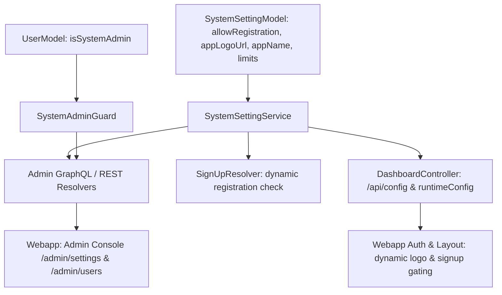

# Admin Settings & System Governance Implementation Plan

> **For agentic workers:** REQUIRED SUB-SKILL: Use superpowers:subagent-driven-development (recommended) or superpowers:executing-plans to implement this plan task-by-task. Steps use checkbox (`- [ ]`) syntax for tracking.

This plan details the implementation of a dedicated **Admin Settings & System Governance** subsystem in KyndForm. It introduces system-level administrator roles, dynamic runtime controls (registration toggling, custom platform branding/logo), user account management (blocking, admin promotion), and fixes legacy branding assets (`logo.svg`, `og.svg`, and `LogoIcon.tsx`).

---

## 1. High-Level Architecture

---

## 2. File Topology & Changes

| Package | File | Action | Purpose |
| :--- | :--- | :--- | :--- |
| `packages/server` | `src/model/user.model.ts` | **Modify** | Add `isSystemAdmin?: boolean` to UserModel schema |
| `packages/server` | `src/model/system-setting.model.ts` | **Create** | Mongoose schema for persistent system-wide configuration |
| `packages/server` | `src/model/module.ts` | **Modify** | Register `SystemSettingModel` in Mongoose module |
| `packages/server` | `src/service/system-setting.service.ts` | **Create** | Caching and persistence service for system settings |
| `packages/server` | `src/service/module.ts` | **Modify** | Export `SystemSettingService` |
| `packages/server` | `src/common/guard/system-admin.guard.ts` | **Create** | Guard checking `req.user.isSystemAdmin === true` |
| `packages/server` | `src/common/graphql/admin.graphql.ts` | **Create** | GraphQL input and type definitions for admin settings & user management |
| `packages/server` | `src/resolver/admin/admin-setting.resolver.ts` | **Create** | Query `systemSettings` & Mutation `updateSystemSettings` |
| `packages/server` | `src/resolver/admin/admin-user.resolver.ts` | **Create** | Query `adminUsers`, Mutation `adminToggleUserBlock`, `adminToggleUserRole` |
| `packages/server` | `src/resolver/user/user-detail.resolver.ts` | **Modify** | Include `isSystemAdmin` in `userDetail` GraphQL response |
| `packages/server` | `src/resolver/auth/sign-up.resolver.ts` | **Modify** | Check `SystemSettingService.isRegistrationAllowed()` dynamically |
| `packages/server` | `src/controller/dashboard.controller.ts` | **Modify** | Inject dynamic `appDisableRegistration`, `appLogoUrl`, `appName` into `/api/config` & `window.kyndform` |
| `packages/server` | `src/environments/index.ts` | **Modify** | Support `ADMIN_EMAILS` environment variable |
| `packages/webapp` | `src/types/user.ts` | **Modify** | Add `isSystemAdmin?: boolean` to `UserType` |
| `packages/webapp` | `src/consts/env.ts` | **Modify** | Read dynamic `appLogoUrl` and `appName` from `window.kyndform` |
| `packages/webapp` | `src/services/admin.ts` | **Create** | GraphQL & API client for admin settings & user governance |
| `packages/webapp` | `src/routes/index.ts` | **Modify** | Add protected routes `/admin/settings` and `/admin/users` |
| `packages/webapp` | `src/layouts/Workspace/WorkspaceAccount.tsx` | **Modify** | Display "Admin Console" in user dropdown menu for system admins |
| `packages/webapp` | `src/pages/admin/Settings.tsx` | **Create** | Admin Settings UI (Registration toggle, App logo upload/preview, limits) |
| `packages/webapp` | `src/pages/admin/Users.tsx` | **Create** | Admin Users UI (User directory, block/unblock, admin role toggle) |
| `packages/webapp` | `src/assets/logo.svg` | **Modify** | Replace legacy logo with official modern KyndForm SVG vector logo |
| `packages/webapp` | `src/assets/og.svg` | **Modify** | Replace legacy OpenGraph share card with clean KyndForm branding |
| `packages/webapp` | `src/pages/form/Render/components/LogoIcon.tsx` | **Modify** | Replace inline legacy paths with KyndForm branding |
| `packages/form-renderer` | `src/components/Icons/LogoIcon.tsx` | **Modify** | Replace inline legacy paths with KyndForm branding |

---

## 3. Step-by-Step Implementation Tasks

### Task 1: Asset & Branding Modernization (Logo, Social Preview, Icons)
- [ ] In `packages/webapp/src/assets/logo.svg`, replace the old H-shape logo with a clean, modern KyndForm vector logo (distinctive 'K' form-flow mark in vibrant blue/indigo).
- [ ] In `packages/webapp/src/assets/og.svg`, replace the old HeyForm text and embedded PNG with an elegant KyndForm OpenGraph card.
- [ ] In `packages/webapp/src/pages/form/Render/components/LogoIcon.tsx` and `packages/form-renderer/src/components/Icons/LogoIcon.tsx`, update the SVG vector paths to match the KyndForm mark.
- [ ] Verify build and type-check: `pnpm run type-check`.

### Task 2: Backend System Admin Role & Model Extension
- [ ] In `packages/server/src/model/user.model.ts`, add `@Prop({ default: false }) isSystemAdmin?: boolean;`.
- [ ] In `packages/server/src/environments/index.ts`, add `ADMIN_EMAILS` parser (splits comma-separated list of admin emails).
- [ ] In `packages/server/src/service/user.service.ts`:
  - When creating a user, if `ADMIN_EMAILS.includes(email.toLowerCase())` or if the user count in the database is 0 (first user), automatically set `isSystemAdmin: true`.
- [ ] In `packages/server/src/resolver/user/user-detail.resolver.ts` and `packages/server/src/common/graphql/user.graphql.ts`, expose `isSystemAdmin` in `UserDetailType`.
- [ ] Create `packages/server/src/common/guard/system-admin.guard.ts` to reject non-admin requests with `ForbiddenException`.

### Task 3: Dynamic System Settings Model & Service
- [ ] Create `packages/server/src/model/system-setting.model.ts` with fields:
  - `allowRegistration: boolean`
  - `appLogoUrl?: string`
  - `appName?: string`
  - `maxFormsPerWorkspace?: number`
  - `maxSubmissionsPerMonth?: number`
  - `maxUploadFileSizeMB?: number`
- [ ] Register `SystemSettingModel` in `packages/server/src/model/module.ts`.
- [ ] Create `packages/server/src/service/system-setting.service.ts` with:
  - `getSettings()`: Cached read with fallback to defaults and environment variables (`APP_DISABLE_REGISTRATION`).
  - `updateSettings(partial)`: Persists updates to MongoDB and invalidates in-memory cache.
  - `isRegistrationAllowed()`: Helper returning boolean.
- [ ] Inject `SystemSettingService` into:
  - `DashboardController`: Use dynamic settings in `runtimeConfig()`, `/api/config`, and `/sign-up` route redirect.
  - `SignUpResolver`: Check `isRegistrationAllowed()` instead of static `APP_DISABLE_REGISTRATION`.
  - `SocialLoginService`: Check `isRegistrationAllowed()` for new social signups.

### Task 4: Admin GraphQL Resolvers & Mutation APIs
- [ ] Create `packages/server/src/common/graphql/admin.graphql.ts` with types:
  - `SystemSettingsType`, `UpdateSystemSettingsInput`
  - `AdminUserItemType`, `AdminUserPaginationType`
- [ ] Create `packages/server/src/resolver/admin/admin-setting.resolver.ts`:
  - `@Query(() => SystemSettingsType) systemSettings()`
  - `@Mutation(() => SystemSettingsType) updateSystemSettings(@Args('input') input: UpdateSystemSettingsInput)`
  - Protected with `@UseGuards(AuthGuard, SystemAdminGuard)`.
- [ ] Create `packages/server/src/resolver/admin/admin-user.resolver.ts`:
  - `@Query(() => AdminUserPaginationType) adminUsers(@Args('page') page: number, @Args('limit') limit: number, @Args('keyword') keyword?: string)`
  - `@Mutation(() => Boolean) adminToggleUserBlock(@Args('userId') userId: string)`
  - `@Mutation(() => Boolean) adminToggleUserRole(@Args('userId') userId: string)`
- [ ] Register resolvers in `packages/server/src/resolver/module.ts` and `packages/server/src/app.module.ts`.

### Task 5: Webapp Admin Console UI & Routes
- [ ] In `packages/webapp/src/types/user.ts`, add `isSystemAdmin?: boolean` to `UserType`.
- [ ] Create `packages/webapp/src/services/admin.ts` with Apollo queries and mutations for system settings and user management.
- [ ] Create `packages/webapp/src/pages/admin/AdminLayout.tsx` providing an admin sidebar/tabs:
  - "General Settings" (Registration, Logo, App Name, Limits)
  - "User Management" (User Directory, Roles, Blocking)
- [ ] Create `packages/webapp/src/pages/admin/Settings.tsx`:
  - Registration toggle switch with clear status indicator.
  - Logo upload component (using KyndForm MediaPicker or URL) with instant preview.
  - System limits input fields (Max forms, Max submissions, Upload size).
  - Save Changes button with toast notifications.
- [ ] Create `packages/webapp/src/pages/admin/Users.tsx`:
  - Searchable user table.
  - Displays avatar, name, email, role badge (`System Admin` or `Standard User`), status badge (`Active` or `Blocked`), join date.
  - Actions: "Toggle Admin" and "Block/Unblock User".
- [ ] In `packages/webapp/src/routes/index.ts`, add `/admin/settings` and `/admin/users` routes protected by an `AdminGuard`.
- [ ] In `packages/webapp/src/layouts/Workspace/WorkspaceAccount.tsx`, render "Admin Console" with a shield icon in the account dropdown when `user.isSystemAdmin === true`.

### Task 6: Dynamic Logo Rendering Across Webapp
- [ ] In `packages/webapp/src/layouts/Workspace/index.tsx` (sidebar) and `packages/webapp/src/layouts/Auth/index.tsx` (auth pages):
  - Read `appLogoUrl` from `window.kyndform` / runtime config.
  - If `appLogoUrl` is set, render ``.
  - If not set, render the bundled `<Logo className="h-8 w-auto" />`.

### Task 7: Verification & Testing
- [ ] Run `pnpm run verify:integrity` to confirm all 14 architectural checks pass.
- [ ] Run `pnpm type-check` across all workspace packages.
- [ ] Run `pnpm test` to verify zero regression across unit test suites.
- [ ] Run `pnpm lint` to ensure code formatting and linting pass cleanly.
